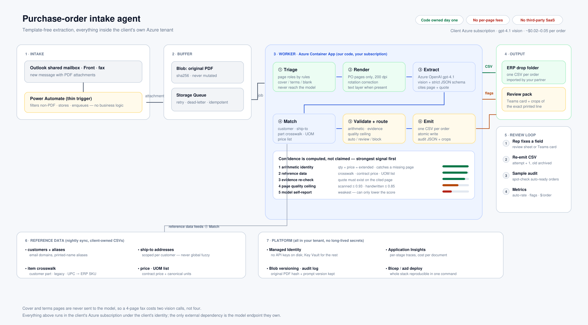

# 采购订单 AI Agent — 实现方案（v1，讨论稿）

> 客户：美国医疗用品制造商/分销商 · 甲方自建自持 · Microsoft 环境 · 2 周原型 / 6–8 周上线
> 本文是**技术方案**；报价与排期见 `02_里程碑与报价.md`，风险与待确认项见 `03_风险与问题清单.md`，
> 投标用的中英文提案见 `04_proposal_bilingual.md`，本地运行步骤见 `05_本地运行指南.md`。
> 配套可运行原型在 `demo/`（`make demo` 直接跑，输出 CSV + 复核台 + 指标）。
> 架构图：`docs/diagram/architecture.svg`（源码 `docs/diagram/build_arch.py`，可重新生成）。



---

## 0. 先说三个判断（决定了方案的形状）

**判断一：这活的核心不是「读 PDF」，而是「让一个不敢出错的人愿意相信它」。**
客户已经明说每条订单都会有人复核、CSV 由 ERP 集成商导入、重复单下游查。那么我们的产品不是"抽取器"，而是**一份让人 30 秒内能判断「这条能放行吗、要改哪」的证据包**。方案里 60% 的工作量应该花在这里，而不是花在 prompt 调优。

**判断二：不要做"每家客户一个模板"，但也不要做"一个 prompt 打天下"。**
正确形态是**格式无关的语义抽取 + 结构化常识校验 + 主数据匹配**三层。
客户说的"不能按客户建模板"是对的，但他们没意识到的推论是：**准确率的来源会从"模型读得准"转移到"系统能不能自己发现读错了"**。所以整个方案的骨架是"校验优先"（validation-first），不是"抽取优先"。

**判断三：Power Automate 只能当"邮差"，不能当"大脑"。**
客户偏好 Power Automate（合理，他们是 MS 店）。但把 PDF 分页渲染、旋转矫正、多页合并、模糊匹配、金额核对、CSV 生成、复核页渲染塞进 Power Automate 里，会得到一个**无法测试、无法版本化、无法交接**的流。这也是他们最担心的"另一个开发者能不能维护"。
所以：**Power Automate 负责"事件 + 文件搬运 + 通知"，真正的处理跑在我们交付的容器/Function 里**。这条要在第一次视频会议上讲清楚，并给两条路线让他们选（见 §2.3）。

---

## 1. 需求翻译成验收指标

客户给的是功能描述，不是验收标准。签合同前必须把下面这张表变成合同附件——否则"正确 CSv 输出"永远扯皮。

| # | 要求 | 我们的验收口径（建议写进 SOW） |
|---|---|---|
| 1 | 识别含 PO 的邮件 | 附件级判断，误判率 < 2%；非 PO 附件不产生 CSV，只进"忽略"日志 |
| 2 | 字段抽取 | **行级** F1 ≥ 0.98（干净 PDF）、≥ 0.90（扫描/传真）、手写单另算（只承诺"人工确认成本下降"，不承诺自动率） |
| 3 | 未见过的格式 | 抽 20% 客户样本做 **hold-out 格式测试**：这些客户的格式不得出现在开发/调优样本里；hold-out 上字段准确率不得比训练集低 5 个点以上 |
| 4 | ERP 匹配 | 料号匹配率 ≥ 97%（含客户/legacy 料号 crosswalk）；**零误配**是硬指标——宁可 flag 也不能错配 |
| 5 | 标记不确定 | 所有 BLOCK 级 flag 必须能定位到**页码 + 原文片段**；人工复核平均耗时 ≤ 90 秒/单 |
| 6 | CSV 输出 | 与集成商联调通过 100% 样本单；重复提交幂等；文件名/编码/换行符按规范 |

> 现在的原型已经把这些指标里的**可机检部分**做成了自动化测试（`demo/tests/test_pipeline.py`），上线后同一套测试跑真实样本，就是回归测试。

---

## 2. 架构

### 2.1 数据流

```
Outlook / Front 收件箱
        │  (1) 新邮件（共享邮箱 · Graph change notification 或 Power Automate 触发）
        ▼
┌───────────────────────────────────────────────────────────────┐
│  ingestion（Power Automate 或 Graph webhook，二者等价）         │
│  取附件 → 过滤非 PDF → 存 Blob → 写 job 到 Storage Queue        │
└───────────────────────────────────────────────────────────────┘
        │
        ▼
┌───────────────────────────────────────────────────────────────┐
│  worker（Container App，我们的代码，跑在客户的 Azure 订阅里）      │
│                                                               │
│  ① triage     规则+轻量视觉分类：page role / 方向 / 是否扫描件    │
│  ② render     只把 PO 页渲染成图（200dpi），封面/条款页不花钱      │
│  ③ extract    Azure OpenAI gpt-4.1 视觉 + JSON Schema 结构化输出  │
│  ④ validate   算术对账 / 主数据匹配 / 证据回查 / 质量折算          │
│  ⑤ route      auto_ready · needs_review · blocked               │
│  ⑥ emit       CSV → ERP 投递目录（原子写）；复核包 → HTML/Teams    │
└───────────────────────────────────────────────────────────────┘
        │                        │
        ▼                        ▼
   ERP drop folder          Teams 卡片 + 复核页（含原文截图）
   (集成商进程消费)          人工改完 → 重出 CSV（attempt+1，旧文件归档）
```

关键点：**worker 无状态**，输入是 PDF + 邮件元数据，输出是 CSV + JSON 证据包。这让 M1 原型和 M2 生产是同一份代码，只是换了触发源和存储。

### 2.2 分层与职责

| 层 | 组件 | 为什么在这层 |
|---|---|---|
| 触发 | Power Automate（首选）/ Graph 订阅 | 客户环境里已有、IT 好批、邮件侧权限天然在这里 |
| 编排 | Azure Storage Queue + Container App | 重试、并发、死信、幂等都要有人管；PA 不适合 |
| 抽帧 | PyMuPDF（开源，随镜像分发） | 分页渲染、旋转、裁剪；比 Document Intelligence 便宜且不需要按页计费 |
| 抽取 | Azure OpenAI `gpt-4.1`（视觉） | 见 §3 |
| 校验/匹配 | 纯 Python + 客户 ERP 主数据 CSV | 确定性代码，可单测、可解释、不花 token |
| 输出 | CSV 写入 + HTML 复核页 + Teams 卡片 | 复核入口贴着他们日常工具 |
| 可观测 | Application Insights + 每次运行的 `metrics.json` | 客户要能自己看准确率趋势 |
| 密钥 | Key Vault + Managed Identity | 无密码、无 key 落地 |

### 2.3 关于 Power Automate 的两条路线（让客户选）

| 路线 | 形态 | 优点 | 代价 |
|---|---|---|---|
| **A（推荐）PA 薄触发** | PA 只做「新邮件→附件→存 Blob→调用 HTTP 端点」，业务逻辑在容器里 | 可测试、可版本化、可交接；模型/规则升级不动 PA | 需要客户同意多一个 Container App（成本约 $20–60/月） |
| **B 全 PA + Azure AI 连接器** | PA 里直接调 Azure OpenAI 连接器，用 Excel/SharePoint 存状态 | 完全在客户熟悉的工具里 | 无回归测试、无证据回查、多页/旋转/大 PDF 基本做不动；6–8 周做不出可靠版 |

我们的方案按 A 交付，但在 M1 结束时把 B 的可行性数据摆出来（同一批样本上 B 的准确率通常低 10–20 个点），让客户自己确认。

---

## 3. 模型选型（客户明确问"用哪个模型，为什么"）

| 方案 | 结论 | 理由 |
|---|---|---|
| **Azure OpenAI `gpt-4.1`（视觉，主）** | ✅ 主抽取器 | 格式无关（无需模板/训练）、对手写和传真鲁棒、可直接吃 PNG 不需要先 OCR、走客户自己的 Azure 订阅（无第三方按页费、无数据出境到第三方 SaaS）、结构化输出可强约束 schema |
| `gpt-4.1-mini`（视觉） | ✅ 分页分类 / 方向检测 | 这类判断很便宜，单页 <$0.001，可把 gpt-4.1 的调用压到只处理 PO 页 |
| Azure AI Document Intelligence | ⚠️ 可选，默认不用 | 预置模型强，但按页计费 + 对"没见过的格式/手写"仍需自定义训练；作为**降级 OCR 备选**保留。注意：它是 Azure 原生服务、在客户订阅里，不违反"无第三方 SaaS"，但如果能不用就不用，少一个变量 |
| GPT-4o / o 系列推理模型 | ❌ | 4.1 在文档图上同价位更好，o 系列贵且慢，不划算 |
| 自建开源 VLM（Qwen2.5-VL / Donut） | ❌ 现阶段 | 客户 6–8 周要上线；自托管 GPU 的运维成本 + 准确率风险不值得。可作为 M3 的降本选项（他们关心长期成本时可提） |
| 传统 OCR + 规则/模板 | ❌ | 与"不能按客户建模板"直接冲突 |

**成本量级（按 gpt-4.1 列表价 $2/$8 每百万 token 估算）**：
单份 2 页 PO ≈ 6k 输入 token + 700 输出 token ≈ **$0.018/单**；含分页分类与重试 ≈ **$0.02–0.05/单**。
200 单/日 × 22 天 → **$90–220/月**。这比任何按页 SaaS 便宜一个量级，也是客户最关心的"无 per-order fee"的正面回答。
（原型里每单都真实计量 token 与美元，见 `demo/out/metrics.json`。）

---

## 4. 六个关键设计决策（这些是方案的价值所在）

### D1 校验优先：置信度不是模型说的，是系统算出来的
模型自报的 confidence 是最弱的信号。原型里的证据等级从强到弱：

1. **算术恒等式**：`qty × unit_price == extended_price`，行合计 + 运费 + 税 == 单据总额 → 能抓出"漏了一页""数量抄错""价格串行"
2. **主数据匹配**：料号 crosswalk 命中 / 价目表 / UOM 表
3. **证据回查**：模型必须回引"原文片段 + 页码"，我们用文本层机械搜索；搜不到 = 疑似幻觉，直接降权
4. **页面质量**：扫描件、旋转、手写 → 给置信度**硬上限**（扫描 0.93 / 手写 0.85）
5. **模型自述**：只作参考

> 效果：干净 PDF 可以做到不打扰人直接进 ERP；一张歪的传真在手写页上永远不会被"自信地放行"。

### D2 三分支路由，而不是"全进人工"或"全自动"
- `auto_ready`：无 flag 且置信度 ≥ 0.92 → 直接出 CSV（**但依然有日终抽检**）
- `needs_review`：有 REVIEW flag 或置信度不足 → 出 CSV **到暂存区** + 复核卡片
- `blocked`：缺 PO 号 / 客户未匹配 / 料号未匹配 → **不产生 CSV**，只发复核任务

原型里 4 个样本单天然落在三个分支上（1 / 2 / 1），可以直接演示"哪些单子会烦到人、哪些不会"。

### D3 匹配必须先"收窄范围"再"算相似度"
- 收货地址只在**已匹配客户的地址簿内**比对（全库模糊匹配 = 把货发错医院）
- 料号匹配阶梯：客户料号 crosswalk → 全局 legacy/UPC 料号 → ERP SKU → 描述模糊匹配（≥93 自动，86–93 复核，<86 flag）
- **客户专属料号绝不对其他客户可见**（原型里这条本来写错了，是被 `tests/test_matching.py` 抓出来的——正好是这类项目最容易踩的坑）
- 两个候选分差 < 4 分时**返回歧义而不是选最高分**

### D4 UOM 单独治理，绝不"顺手翻译"
`EA / BX / CS / PK / BG` 猜错一个就是数量错 10–100 倍，且医疗用品有监管后果。
做法：维护显式映射表；映射不上就 flag（`UOM_UNMAPPED`），和 ERP 物料 UOM 不一致就 BLOCK（`UOM_MISMATCH`）。宁可让人看一眼，也不"智能化"。

### D5 证据可回看：flag 必须能指出"就是这行字"
复核页（`demo/out/review/review.html`）每个 flag 旁边贴一张**原文截图**：文本层 PDF 用字符串搜索精确定位；扫描/传真用模型返回的 `bbox`（归一化坐标）反算裁剪区域，含旋转页的坐标反变换（`tests/test_crop.py` 专门守这个回归）。
复核员看到的不是"AI 说价格不对"，而是"AI 圈出了那一行，价格是 63.40，合同价是 61.00"。

### D6 成本控制做在 triage 层
封面页、条款页、空白页**不送 vision 模型**（原型里那张 4 页传真只送了 2 页）。
另外：文本层可用的 PDF 直接给文本 + 图（文本省 token、图补表格结构）；重试带指数退避，同一份文件同一页不重复付费。

---

## 5. 原型已验证到什么程度（`demo/`）

```bash
cd demo && make setup && make demo     # 无 key、无网络，20 个测试全绿
```

| 能力 | 状态 |
|---|---|
| 邮件 → 附件 → 处理 → CSV 落盘 | ✅ 跑通（`samples/mail_manifest.json` 模拟 Graph 消息） |
| 页面 triage（PO / 续页 / 封面 / 条款 / 空白） | ✅ 规则版；扫描件走 `page_roles()` 视觉分类接口（已留桩） |
| 旋转 / 扫描 / 传真 / 手写样本 | ✅ 4 份合成样本，其中传真与手写是**真图片无文本层**（`samples/rasterize.py` 加噪、倾斜、横向进纸） |
| 抽取器可替换 | ✅ `FixtureExtractor`（回放录制结果，离线可测）↔ `AzureOpenAIExtractor`（生产，严格 JSON Schema） |
| 校验 / 匹配 / 路由 / flag | ✅ 20 条 flag 码，三分支路由，置信度上限 |
| CSV 生成 | ✅ 声明式列规范（`config/settings.json`），集成商改格式 = 改配置 |
| 复核页（含原文截图） | ✅ 单文件 HTML，可直接发给客户看 |
| 指标 | ✅ `metrics.json`：自动放行率、平均置信度、每单成本、flag 分布 |
| 测试 | ✅ 20 passed（含"客户料号不能跨客户匹配""旋转页 bbox 裁剪"这类硬回归） |

**尚未验证、M1 要做的**：接真实 Azure OpenAI 跑客户样本；用真实 ERP 主数据（料号 crosswalk 是成败关键）；集成商的 CSV 规范；Front 与共享邮箱的读取权限。

---

## 6. 参考资料（客户会问的合规问题）

- 数据不离开客户 Azure 订阅；Azure OpenAI 默认**不使用客户数据训练**（需在合同里确认数据驻留区域）
- 全链路 Managed Identity + Key Vault，无长期密钥
- 每份订单的中间产物（原 PDF 哈希、抽取 JSON、prompt 版本、模型名、token 数、flag 列表）都留档 → 可追溯、可审计、可复现
- 代码 MIT/自有版权，文档含运维手册与"如何换模型/换字段"的 runbook

---

## 7. 一页话总结（可以贴进 Upwork 提案）

> We build a **validation-first, template-free** PO intake agent that runs entirely inside your Azure tenant:
> a Power Automate trigger hands each PDF to a small containerised worker, which triages pages (cover/terms pages are never sent to the model), renders only the order pages, extracts structured JSON with **Azure OpenAI gpt-4.1 vision under a strict schema**, then proves the result with arithmetic reconciliation, ERP crosswalks and address matching before writing one CSV per order.
> Anything the system cannot prove gets flagged **with a cropped screenshot of the exact line on the page**, so your reps review in seconds instead of re-keying. Handwriting and sideways faxes are supported but **never silently released** — confidence is hard-capped by document quality, not by what the model claims.
> Estimated model cost: **$0.02–0.05 per order**, no per-page or per-transaction fees, no third-party SaaS, all code and infrastructure in your name from day one.
