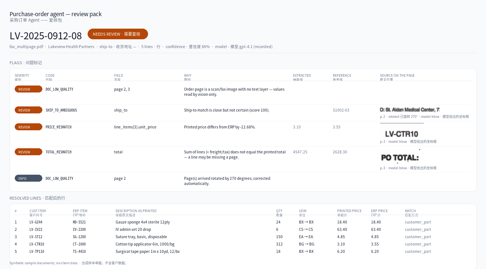
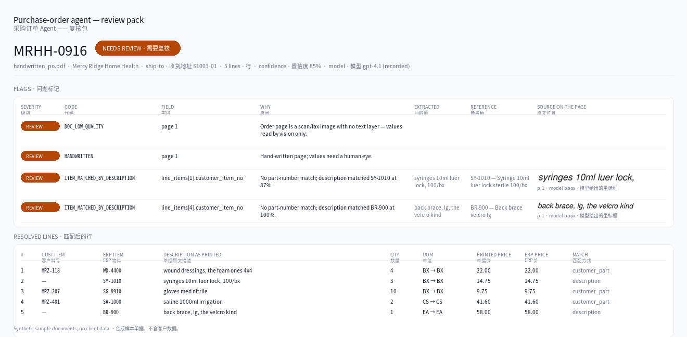

# Proposal — Purchase-Order AI Agent (bilingual / 中英对照)

> Paste-ready proposal for Upwork. English first (that is what the client reads),
> 中文对照在后半部分，方便你核对口径。
>
> **上客户时的附件用这几个（全英文）：**
> `docs/diagram/architecture_en.png`（架构图）+ `docs/images/review_card_*.png`（复核卡，用 `python -m chronik.preview --lang en` 重新生成即全英文）。
> 内部讨论时用双语版：`docs/diagram/architecture.png`。
>
> *Attachments for the client (English only): `architecture_en.png` + the review cards regenerated with `--lang en`. Internal review: the bilingual `architecture.png`.*

---

# PART A — English proposal

## A1. Short cover note (Upwork message box)

> Hi — we build document-intake systems for distributors and we read your brief the
> way you probably did not intend it: the hard part is not reading PDFs, it is
> **proving that what was read is right**, because a rep who cannot trust a queue will
> re-key every order anyway.
>
> We have already built and tested the core of this system as a working prototype
> (template-free extraction, sideways fax correction, ERP crosswalk matching,
> arithmetic reconciliation, CSV output, and a review sheet that shows a cropped
> screenshot of the exact line behind every flag). You can run it yourself before you
> talk to us — links are in the proposal.
>
> Proposed: **$7,500 for a working prototype in 2 weeks, $22,000 to production in
> 4–6 further weeks.** Everything runs in your Azure subscription under your
> identity; estimated model cost **$0.02–0.05 per order**, no per-page or
> per-transaction fees, no SaaS. If the two-week prototype does not meet the
> acceptance criteria we define together, you stop there and pay only that milestone.

## A2. What we understand you are buying

Not a document-reading demo. Three things:

1. **A rep who trusts the queue.** Every order arrives with a machine-checked verdict:
   clean enough to import, or exactly which field to look at and why — with the
   source line highlighted on the page.
2. **No per-customer templates.** Extraction is format-agnostic; correctness comes
   from ERP reference data, arithmetic and evidence checks, not from knowing the
   customer's layout.
3. **An asset you own.** Code, infrastructure, documentation and accounts in your
   name from day one, with a regression suite that tells the truth about accuracy on
   your worst documents.

## A3. Architecture at a glance

See the attached diagram. In one paragraph:

A **thin Power Automate (or Microsoft Graph) trigger** picks up new mail with PDF
attachments, stores the original to Blob with its sha256 and enqueues a job. A small
**containerised worker** — our code, deployed into your Azure subscription — then:
triages pages (cover sheets, terms pages and blanks are **never** sent to the model,
so a 4-page fax costs two vision calls, not four); renders only the order pages with
rotation correction; extracts structured JSON with **Azure OpenAI gpt-4.1 vision under
a strict JSON schema**, where every field must cite the page and the printed text it
came from; matches customer, ship-to, item and price against your ERP reference data;
reconciles arithmetic; and writes **one CSV per order** plus a review pack. Orders that
cannot be proven are blocked and routed to a rep, not silently imported.

## A4. Tools and model — and why

| Choice | Why this, and not the alternative |
|---|---|
| **Azure OpenAI `gpt-4.1` (vision)** as the extractor | No templates, no per-customer training, handles faxes, rotations and handwriting; runs in **your** subscription so there is no third-party per-page fee and no data leaving your tenant to a document-processing SaaS. Strict structured output means the model physically cannot return a malformed record. |
| **`gpt-4.1-mini`** for page classification / orientation | This is a cheap, boring decision; spending a large model on it would triple cost for no accuracy. |
| **Power Automate as trigger only** | It is the right tool for "new mail → file → notify", and your IT already approves it. Business logic in flow steps cannot be unit-tested or versioned — and you told us another developer must be able to maintain this. (If you prefer everything inside Power Automate, we will show you the accuracy and maintainability cost on your own samples before you decide.) |
| **PyMuPDF** for rendering/rotation/cropping | Open source, ships in our image, no per-page licence. |
| **Azure AI Document Intelligence** | Kept as an optional fallback OCR path, not the primary. It is Azure-native (so it does not violate your no-SaaS rule) but it is per-page-priced and still needs custom models for unseen layouts — exactly what you said you do not want. |
| Deliberately **not** used | Third-party IDP SaaS, per-page APIs, template-per-customer engines, self-hosted open-source VLMs (added GPU ops risk, no accuracy gain at your volume — revisit only if you exceed ~2,000 orders/day). |

## A5. The six decisions that make this work

1. **Confidence is computed, not claimed.** The model's own confidence is the weakest
   signal we have. Ranking: (1) arithmetic identity — qty × price = extended, lines +
   freight + tax = printed total, which is what catches a missing page or a
   transposed quantity; (2) ERP reference data — crosswalk hit, contract price, UOM;
   (3) **evidence re-check** — every value must come with the printed quote and page,
   and we mechanistically verify the quote exists; a value whose quote cannot be found
   is treated as a hallucination; (4) document quality — scanned pages are hard-capped
   at 0.93, handwriting at 0.85; (5) model self-report.
2. **Three routes, not "all human" or "all automatic".** `auto_ready` (no flags, high
   confidence) → straight to the ERP folder; `needs_review` → CSV to a staging folder
   plus a review card; `blocked` (missing PO number, unknown customer or item) → **no
   CSV at all**. Your reps' attention is spent where it changes the outcome.
3. **Matching narrows before it scores.** A ship-to address is only compared inside the
   matched customer's address book — fuzzy matching across the whole file is how you
   ship to the wrong hospital. Item ladder: customer part crosswalk → global legacy/UPC
   → ERP SKU → description similarity. **A customer-specific part number is never
   visible to another customer.** When two candidates are within a few points we return
   *ambiguous*, never the top scorer.
4. **Units of measure are governed, never "helpfully" translated.** EA vs BX vs CS is a
   10–100× quantity error with regulatory consequences in medical supply. Unknown UOM
   is flagged; UOM conflicting with the ERP item blocks the order.
5. **Evidence you can look at.** Each flag carries a crop of the source: located by text
   search on born-digital pages, by the model's bounding box on scans, with correct
   coordinate mapping for sideways pages. The rep verifies the document, not the agent.
6. **Cost control sits in triage.** Cover/terms/blank pages are excluded before any
   model call; text layers are used where they exist; retries are bounded and deduped
   by attachment hash.

## A6. Milestones and pricing

| | Scope | Duration | Fixed price |
|---|---|---|---|
| **M1 — working prototype** | Your sample orders end-to-end: triage, extraction, ERP matching, flags, CSV in your format, review sheet, accuracy report on your own documents | **2 weeks** | **$7,500** |
| **M2 — production-ready** | Deployed in your Azure tenant (Bicep), mail trigger, nightly ERP reference sync, review workflow with re-emit, regression suite on ≥100 of your orders, UAT with your reps, integration-partner joint test, runbook + handover | **4–6 weeks** | **$22,000** |
| **Total** | | **6–8 weeks** | **$29,500** |

Optional ongoing support (separately quoted, as requested):
**$1,900/month** (8 hours included, 4-hour weekday response, monthly accuracy report
and mis-flag review) · **$950/month** light (monitoring + report only) · **$135/hour**
on demand.

**Payment:** M1 50% on start / 50% on acceptance. M2 in three milestone payments
(30/30/40). Model usage is billed by Azure directly to your subscription — we never
resell tokens.

**M1 acceptance criteria (proposed, to be finalised with you):** given ≥20 of your real
sample orders covering ≥5 customer formats (including at least two fax/scan and one
handwritten), each order produces one CSV; field-level accuracy ≥95% overall with
tiered targets by document class; and **every uncertain field carries a flag that
points to a page and a visible crop of the source text**.

## A7. Risks we are already planning for

| Risk | Our mitigation |
|---|---|
| **HIPAA** — a home-health customer's PO may contain patient names | Extraction schema carries no patient fields; no document text in logs; we ask you to confirm BAA/regional requirements before M1 so the model endpoint is configured correctly from day one |
| **Part crosswalk is incomplete** (customer ↔ legacy ↔ ERP SKU) | We audit crosswalk coverage on day one of M1 and report "how many lines only matched by description"; if coverage is below ~80% we tell you immediately rather than hiding it behind a good average |
| "Unseen formats" vs an accuracy promise | Tiered acceptance (born-digital / scanned / handwritten) plus a **hold-out format test**: customer formats that never appear in tuning must not lose more than 5 points |
| Flag fatigue — reps ignore a noisy queue | Flags limited to three severities, every flag actionable, flag density tracked per day (target ≤2.5 per order); M1 review sheet is time-tested with two real reps |
| CSV spec owned by your integration partner and likely to change | Format is a declarative column spec in config, not code: a spec change is a config diff plus a regression run; two revisions included |
| Mail access / fax mailbox location delays kickoff | Day-one permissions checklist, with a folder-watch mode as a fallback so M1 can start while IT catches up |

## A8. Out of scope (explicitly)

ERP import logic, duplicate detection, downstream approval workflow (your integration
partner); releasing orders; invoices, packing lists, ASNs (reusable pipeline, priced
separately at $3,500 per additional document type); non-English documents.

## A9. What you can run today

A self-contained prototype with four **synthetic** sample orders — a clean
born-digital PO, a sideways 300-dpi fax with a cover sheet and terms page, a
handwritten form, and a customer format never seen before — plus a recorded
extraction replay so the whole pipeline runs with no credentials:

```
$ make demo
document             route          conf  lines  flags
clean_po.pdf         auto_ready     0.99      6  —
fax_multipage.pdf    needs_review   0.86      5  DOC_LOW_QUALITY, PRICE_MISMATCH, SHIP_TO_AMBIGUOUS, TOTAL_MISMATCH
handwritten_po.pdf   needs_review   0.85      5  HANDWRITTEN, ITEM_MATCHED_BY_DESCRIPTION
unknown_format.pdf   blocked        0.43      4  MISSING_PO_NUMBER, ITEM_NOT_FOUND, UOM_UNMAPPED, ...
```

It writes one CSV per order, a review pack with source crops, and a metrics file
(auto-ready rate, confidence, **cost per order**). 20 automated tests, including the
two that matter most: *a customer part number must never match another customer's
order*, and *a crop must land on the right place on a sideways fax*. The same tests run
against your samples in M1 — that is how accuracy claims stay honest.

**This is what a rep actually sees** (sideways fax, auto-corrected, every flag pointing
at the printed line it came from):





---

# PART B — 中文对照

## B1. 一句话定位

> 这类项目的难点不是"把 PDF 读出来"，而是**证明读出来的东西是对的**。
> 复核员如果不敢信这个队列，最后还是会全部手工重录一遍——项目就等于失败。
>
> 我们已经把这套系统的核心做成了可运行原型（无模板抽取、横向传真矫正、ERP 料号匹配、
> 金额对账、CSV 输出、以及每个 flag 都附原文截图的复核页）。
> 报价：**原型 2 周 $7,500；生产就绪再加 4–6 周 $22,000**。
> 全部跑在客户自己的 Azure 订阅里，模型成本约 **$0.02–0.05/单**，
> 无按页费、无 SaaS、代码和账号从第一天归客户。原型不达标就只付第一阶段。

## B2. 我们理解的交付物（三点）

1. **一个让人敢信的队列**：每单带机器核验过结论——能直接进 ERP，或精确指出"看这个字段，原因在这，原文这一行在这里（附截图）"。
2. **没有按客户模板**：抽取与格式无关；正确性来自 ERP 主数据 + 算术 + 证据回查，而不是"认识这家的版式"。
3. **一份客户自己的资产**：代码/基础设施/文档/账号全在客户名下，并附一套能在客户最脏的文档上讲真话的回归测试。

## B3. 架构一句话

Power Automate（或 Graph 订阅）只做"取信 + 存文件 + 入队"；
一个**跑在客户 Azure 里的容器 worker** 做 triage（封面/条款/空白页根本不送模型，
所以 4 页传真只花 2 次视觉调用）→ 渲染（含旋转矫正）→ **Azure OpenAI gpt-4.1 严格 JSON Schema 抽取**
（每个字段必须回引页码与原文）→ 主数据匹配 → 算术对账 → **每单一个 CSV** + 复核包。
证明不了的单子**不产生 CSV**，转人工。

## B4. 工具与选型理由（对应客户问的"用哪些工具、哪个模型、为什么"）

| 选择 | 为什么不是别的 |
|---|---|
| **Azure OpenAI gpt-4.1 视觉** | 不建模板、不按客户训练；传真/旋转/手写都能读；跑在客户订阅内，无第三方按页费、数据不出租户；严格结构化输出，模型物理上无法返回格式错误的记录 |
| gpt-4.1-mini 做分页/方向判断 | 这是廉价判断，用大模型做等于成本三倍、准确率不变 |
| **Power Automate 只做触发** | "新邮件→文件→通知"它最合适，客户 IT 也好批；但业务逻辑放进流程里就无法单测/无法版本化——而客户明确要求"别人能接手维护"。（如果客户坚持全 PA，我们会在客户自己的样本上先量化代价再定） |
| PyMuPDF | 开源、随镜像、无按页授权 |
| Azure AI Document Intelligence | 只作可选降级 OCR，不做主力：它是按页计费、且未见版式仍要自定义模型——正好是客户不要的东西 |
| 明确不用 | 第三方 IDP SaaS、按页 API、按客户模板引擎、自托管开源 VLM（增加 GPU 运维、当前量级无收益；>2000 单/日再评估） |

## B5. 六个关键设计决策

1. **置信度是算出来的，不是模型说的**：算术恒等式 > 主数据 > 证据回查（引用原文必须能在页面上被机械搜索到，否则视为幻觉）> 文档质量硬上限（扫描 0.93 / 手写 0.85）> 模型自述。
2. **三分支路由**：auto_ready 直投 ERP；needs_review 进暂存 + 复核卡；blocked（缺 PO 号/客户/料号）**不出 CSV**。
3. **匹配先收窄再打分**：地址只在已匹配客户地址簿内比；料号阶梯 = 客户料号 → 全局 legacy/UPC → SKU → 描述模糊；**客户专属料号绝不对其他客户可见**；分差过小返回"歧义"而非最高分。
4. **UOM 单独治理，绝不顺手翻译**（EA/BX/CS 猜错 = 数量错 10–100 倍，医疗有监管后果）。
5. **证据可回看**：文本层按字符串定位、扫描页按模型 bbox 反算、横向页做坐标反变换，复核员看的是原文而不是 AI 的结论。
6. **成本做在 triage**：封面/条款/空白不送模型；有文本层优先用文本；重试有界、按附件哈希去重。

## B6. 里程碑与报价

| | 内容 | 周期 | 固定价 |
|---|---|---|---|
| M1 原型 | 客户样本单端到端：triage、抽取、主数据匹配、flag、按客户格式出 CSV、复核页、准确率报告 | 2 周 | **$7,500** |
| M2 生产 | 客户 Azure 部署（Bicep）、邮件触发、ERP 主数据夜间同步、复核工作流（可重出 CSV）、≥100 单回归集、代表 UAT、与集成商联调、runbook 交接 | 4–6 周 | **$22,000** |
| 合计 | | 6–8 周 | **$29,500** |

可选支持：标准 **$1,900/月**（含 8h，工作日 4 小时响应，月度准确率与误判复盘）· 轻量 **$950/月** · 按需 **$135/h**。
付款：M1 五五开（启动/验收）；M2 三期 30/30/40；模型费用由 Azure 直付客户订阅，我们不转售 token。
M1 验收口径（建议）：≥20 份真实样本、≥5 种客户格式（含 ≥2 份传真/扫描、1 份手写），每单产出 1 个 CSV，整体字段准确率 ≥95% 并按文档类型分层考核，**所有不确定字段都必须带"页码 + 原文截图"的 flag**。

## B7. 我们主动指出的风险

| 风险 | 应对 |
|---|---|
| **HIPAA**：居家护理客户的单子可能带患者姓名 | schema 不含患者字段、日志不落文档文本；M1 前请确认 BAA/地域要求，模型端点从一开始就配对 |
| **料号 crosswalk 不全** | M1 第一天做覆盖率体检，直接告诉客户"多少行只能靠描述匹配"，不拿平均值掩盖 |
| "未见格式"与准确率承诺的矛盾 | 分层验收 + **hold-out 格式测试**（未参与调优的客户格式掉点不得 >5） |
| flag 太吵 → 代表直接忽略（项目最可能的死法） | 只留三级 flag、每条都能行动、按日监控 flag 密度（目标 ≤2.5 条/单）；M1 就请两位真实代表计时试用 |
| CSV 规范由第三方定、可能反复改 | 格式是声明式配置项，改格式 = 改配置 + 回归；含 2 次修订 |
| 邮件/传真邮箱权限卡住开工 | 第一天交权限清单，备选"目录监听模式"先跑起来 |

## B8. 明确不包含

ERP 导入逻辑、查重、下游审批（集成商负责）；放行订单；发票/装箱单/ASN（复用同一管道，$3,500/类另计）；非英文文档。

## B9. 今天就能跑的东西

`demo/` 下 4 份**合成**样本（干净 PDF / 横向 300dpi 传真含封面与条款页 / 手写 / 从未见过的格式）+ 录制的抽取回放，**无需任何 key、无需联网**，`make demo` 一条命令出 CSV、复核页、指标（含每单成本）。

上面两张图就是复核员实际看到的画面（由 `python -m chronik.preview` 生成）：横向传真自动纠正，
每条 flag 都指向原文那一行。20 个自动化测试里有两条最关键：**客户料号不能跨客户匹配**、**横向传真上的截图必须裁对位置**。M1 时同一套测试改用客户的真实样本 —— 这就是"准确率不敢注水"的机制。
